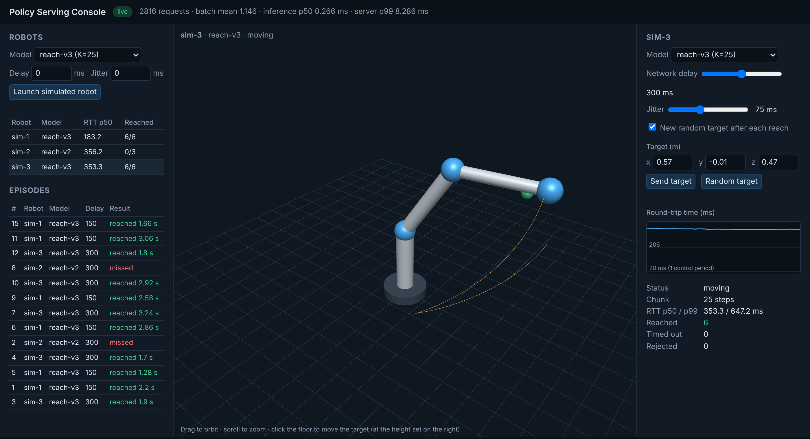
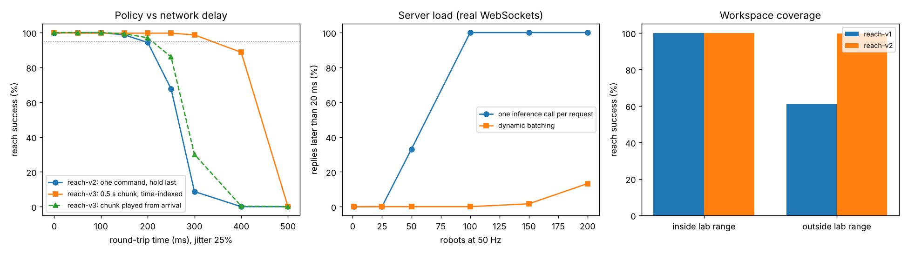

# Robot policy serving: from a research policy to robots over the network

[](https://github.com/vansh0906/robot-policy-serving/actions/workflows/ci.yml)

A learned robot policy goes from the research side (a NumPy network trained by behaviour cloning) to production: it is
exported to ONNX, checked, gated, and served over WebSockets to robots running at 50 Hz. A browser console lets a
customer launch robots, move targets, change models and network delay, and replay any episode in 3-D.

Two customer-style reports drive the work, and each one is reproduced, measured and fixed:
the research model misses targets near the edge of the workspace, and robots on a slow link oscillate.

**Simulated:** the arm (a 3-joint velocity-controlled arm in NumPy, 1 kHz physics), the expert demonstrations, the
network delay and the customer reports. **Real:** the training, the ONNX export, the server, the WebSocket traffic,
the browser console, and every number below, which come from `python run_all.py`.



## Results

| Question | Answer |
|---|---|
| Research to production | NumPy MLP exported to **ONNX** (protobuf written by hand, no `onnx` package); parity **≤ 1.1e-6**; checksum and model card per version |
| Release gate (≥ 95% reach success) | **reach-v1 blocked** (70.0%), reach-v2 99.7%, reach-v3 100% at 0 ms and **98.7% at 300 ms** |
| Customer report 1: misses near the workspace edge | research model reached **60.9%** of targets outside the lab's training range (100% inside); retrained on the full workspace: **99.8%** |
| Customer report 2: oscillation on a slow link | one command per reply, hold last: **94.3%** at 200 ms RTT, **8.7%** at 300 ms. 0.5 s action chunks, time-indexed: **99.7%** at 250 ms, **98.7%** at 300 ms, 88.7% at 400 ms |
| Does the time-indexing matter? | the same chunks played from their arrival instead: **30.0%** at 300 ms |
| Over real WebSockets (4 robots, 300 ms + 75 ms jitter) | single-step model **15%**, chunked model **100%**; 1,219 out-of-order replies dropped by sequence number |
| Server load (robots at 50 Hz, 20 ms deadline) | one inference call per request: **33% late at 50 robots**. Dynamic batching: **0 late at 100 robots** (p99 7.6 ms), 1.6% at 150 |
| Bad robot input (NaN encoder, degrees instead of radians) | rejected with a code and a hint, the robot stops, the server keeps serving |

The WebSocket and load rows are wall-clock measurements, so they move a little between runs.

Full tables: [results/RESULTS.md](results/RESULTS.md) · what was found and changed: [docs/FINDINGS.md](docs/FINDINGS.md) ·
protocol and API: [docs/API.md](docs/API.md)



## Run it

```
python3 -m pip install -r requirements.txt
python3 -m rps.server --sims 1                 # then open http://127.0.0.1:8080
python3 -m rps.client --targets 5 --delay-ms 150   # an external robot over the network, in a second terminal
python3 -m pytest -q                           # 14 tests, about 15 s (the browser test needs Playwright)
python3 run_all.py                             # every study, about 3 minutes
```

No web framework is needed: the server is plain `asyncio` with a small RFC 6455 WebSocket layer (`rps/ws.py`), and
the 3-D view is plain WebGL (`web/gl.js`). Python dependencies: NumPy, ONNX Runtime, Matplotlib, pytest.

## How it fits together

```
 research side                       production side
 rps/data.py   expert demos  ─┐
 rps/policy.py NumPy MLP (BC) ├─► rps/train.py ─► models/reach-vN.onnx + model card (gate, parity, sha256)
 rps/evaluate.py closed loop  ┘                         │
                                                        ▼
 robots (rps/client.py, or simulated  ◄── /ws/robot ──  rps/server.py  ── /ws/viewer ──►  browser (web/)
 on the server) at 50 Hz: send state,     state→act     validate · batch · ONNX Runtime    3-D view, controls,
 execute chunk by time index                            metrics · episodes · HTTP API       replay
```

## Layout

```
rps/arm.py          3-joint arm: kinematics, analytic IK, actuator model, scripted expert, batched versions
rps/data.py         expert demonstrations (DART noise, target changes mid-motion), action-chunk labels
rps/policy.py       MLP with tanh output, Adam training, save/load
rps/evaluate.py     vectorised closed-loop evaluation with a network-delay model (hold / chunk / no-skip)
rps/onnx_export.py  ONNX ModelProto written in protobuf wire format
rps/train.py        builds reach-v1..v3: train, export, parity check, release gate, model card
rps/runtime.py      input validation, ActionBuffer (stale drop + time-indexed chunks), model registry
rps/ws.py           WebSocket server and client on asyncio streams
rps/server.py       HTTP API, robot and viewer WebSockets, dynamic batcher, simulated robots, episodes, metrics
rps/client.py       robot client with network delay and fault injection
web/                console: index.html, app.js (UI), gl.js (WebGL renderer, picking), style.css
tools/loadtest.py   N robots at 50 Hz over real sockets; RTT percentiles and deadline misses
run_all.py          every study -> results/, docs/img/results.png
tests/              kinematics, ONNX parity, gate, validation, execution rule, WebSockets, server, browser
```

## Limits

The arm is my own NumPy model rather than MuJoCo or Isaac Sim, and the task is reaching, not manipulation. The load
test runs the server and the robots on one 2-vCPU machine, and the server is one Python process. Next steps are in
[docs/FINDINGS.md](docs/FINDINGS.md).
